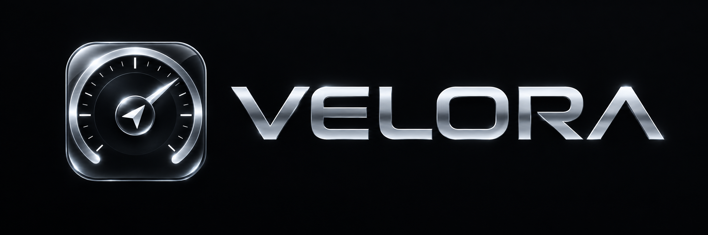
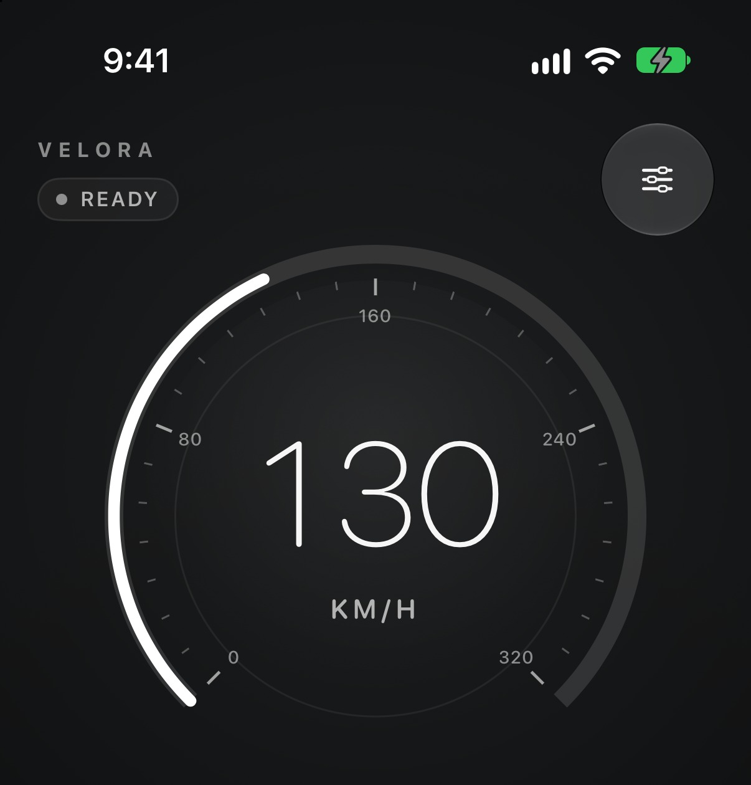
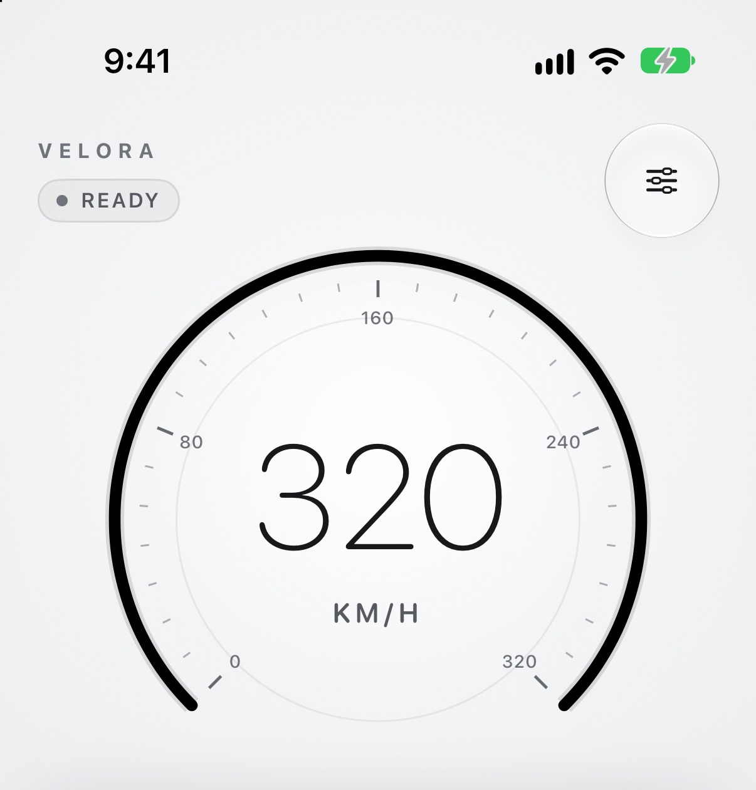

  

<h1 align="center">A precise GPS speedometer for iPhone</h1>

  <strong>Your speed, your trip, on your device.</strong> 
  iOS 26+ · iPhone · km/h and mph · No account · No tracking

  
  

VELORA is a native iPhone speedometer and trip computer for driving. It shows a
clear, glanceable speed reading and keeps a live record of the current trip
without sending location data off the device.

The interface is in English. VELORA is distributed as a sideloaded IPA, not
through the App Store.

## What VELORA does

### A speedometer you can read at a glance

- A large, high-contrast speed display with a 0–320 km/h or 0–200 mph scale.
- Uses the speed reported by iPhone location services when it is reliable and
  fills suitable gaps with a position-based estimate.
- Coarse or stale readings are not presented as a valid speed. When no usable
  reading is available, the gauge shows a dash instead of guessing.
- Switch between km/h and mph in Settings. The choice applies to the gauge and
  every trip value.

### A live trip computer

- Current speed, maximum speed, average speed, distance and trip time.
- Start, pause, resume and reset from the dashboard.
- Active time stops while a trip is paused.
- Leaving the app pauses a running trip. Resume when you return and it is safe to
  do so.
- Distance follows the recorded position path rather than a straight line
  between the start and end points.
- When GPS coverage is incomplete, the average is marked as approximate instead
  of hiding the gap.

### Movement and GPS status

- Movement is confirmed from position data rather than trusting a single speed
  value.
- The dashboard shows whether VELORA is ready, checking movement, moving or
  stationary, alongside GPS health.
- GPS problems are explained in plain language: permission required or denied,
  location services off, waiting for a fix, low accuracy, stale readings or a
  location error.
- Optional GPS Diagnostics show accuracy, update activity and the current
  distance and time accounting for troubleshooting. They never show coordinates
  or addresses.

### Designed for the road

- A graphite interface with coordinated light and dark appearances.
- Liquid Glass controls on iOS 26.
- Dynamic Type support, including a one-column metric layout at accessibility
  sizes.
- VoiceOver labels for the gauge, status cards, metrics and controls.
- Reduce Motion support.
- Portrait layout for one-handed, glanceable use.

## Requirements

- An iPhone running iOS 26.0 or later.
- Location access set to **While Using the App**.
- A VELORA IPA and a compatible sideloading tool. VELORA does not install from
  the App Store.
- The IPA must be signed for your device with your own Apple signing identity.
  The release IPA is ad-hoc signed for packaging and must be re-signed by your
  installer.

## Install

Download the latest IPA from the
[VELORA releases page](https://github.com/CRZX1337/velora-ios/releases).

VELORA can be installed with either of these tools:

| Tool | Best for | What it needs |
| --- | --- | --- |
| [Feather](docs/install-feather.md) | Devices already using certificate-based signing | A signing certificate and provisioning profile |
| [SideStore](docs/install-sidestore.md) | Free Apple Account setups | A computer for initial setup, an Apple Account and LocalDevVPN |

Both guides are based on the tools' official documentation. Third-party
sideloading tools and signing identities are your responsibility. Install only
IPAs obtained from this repository, and never share your signing certificate.

### First trip

1. Open VELORA and allow location access **While Using the App**.
2. Mount the iPhone where you can see it without holding it.
3. Tap **Start Trip**.
4. Use **Pause** and **Resume** as needed. **Reset** clears the current trip.
5. Keep the app in the foreground while recording. VELORA pauses the trip when
   the app leaves the foreground.

If location access was denied, open **Settings → Privacy & Security → Location
Services → VELORA** and allow access while using the app. Enabling **Precise
Location** gives the best speed and distance results.

## Privacy

VELORA is built to keep driving data local.

- No account, sign-in, ads, analytics or tracking.
- No network layer. VELORA does not upload location data.
- Location is requested only while a trip is active. The app does not request
  background location access.
- Diagnostics show status metadata and accuracy, never coordinates or
  addresses.
- Trip data is kept in memory for the current session. It is not stored as a
  trip history and disappears when the trip is reset or the app is terminated.
- Preferences such as units and dashboard cards are stored locally on the
  device.

VELORA's privacy manifest declares no tracking and no collected data types.

## Accuracy and safety

VELORA is a driving aid, not a certified or legal speedometer. GPS speed and
distance can be affected by signal conditions, device placement, tunnels, tall
buildings and other sources of error. Treat all readings as estimates.

Do not rely on VELORA for speed enforcement, navigation, emergency decisions or
any other safety-critical use. Do not interact with the iPhone while driving.

## Troubleshooting

**The gauge shows a dash.**
VELORA has no usable location reading yet. Check that location access is allowed
and that the iPhone has a view of the sky. The GPS status card explains what is
missing.

**Speed or distance looks inaccurate.**
Enable Precise Location, keep the iPhone mounted with a clear view of the sky,
and avoid switching apps during a trip. A weak GPS fix cannot produce a precise
speed or distance.

**The trip paused by itself.**
VELORA pauses when the app leaves the foreground. Return to the app and tap
Resume when it is safe.

**The average is marked approximate.**
There was a gap in GPS coverage. The distance and average for that trip are
incomplete.

**The app will not install.**
Confirm that the IPA was signed for your device, that the signing certificate
has not expired and that the installer supports iOS 26. See the relevant
installation guide for details.

## Support

For bug reports and feature requests, use the
[issue tracker](https://github.com/CRZX1337/velora-ios/issues). Include the
VELORA version from **Settings → About VELORA**, the iOS version and the steps
that led to the problem.

Do not post location traces or other personal data in an issue.

## License

VELORA is proprietary software. Copyright © 2026 VELORA. All rights reserved.
Public visibility of this repository does not grant permission to use, copy,
modify, or redistribute the software. See [LICENSE](LICENSE) for the full
terms.
